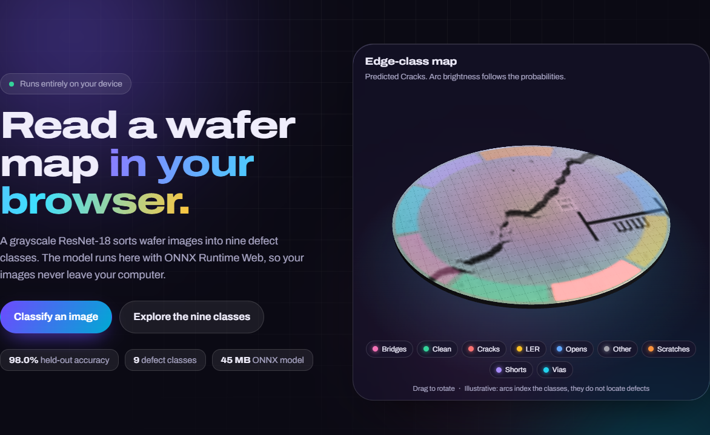
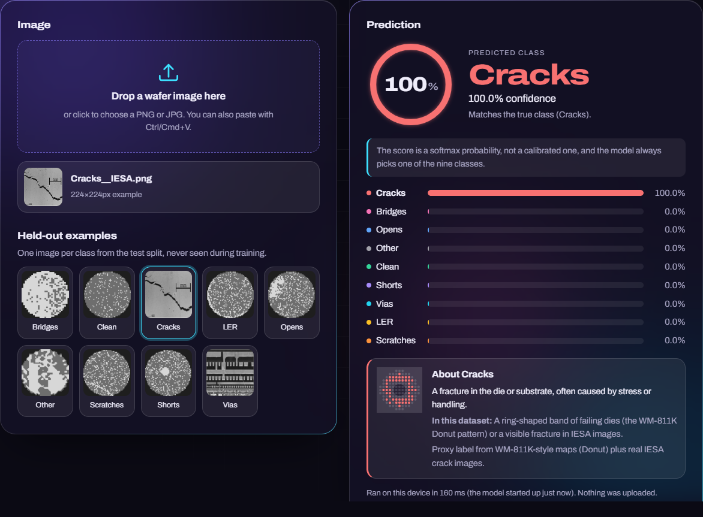
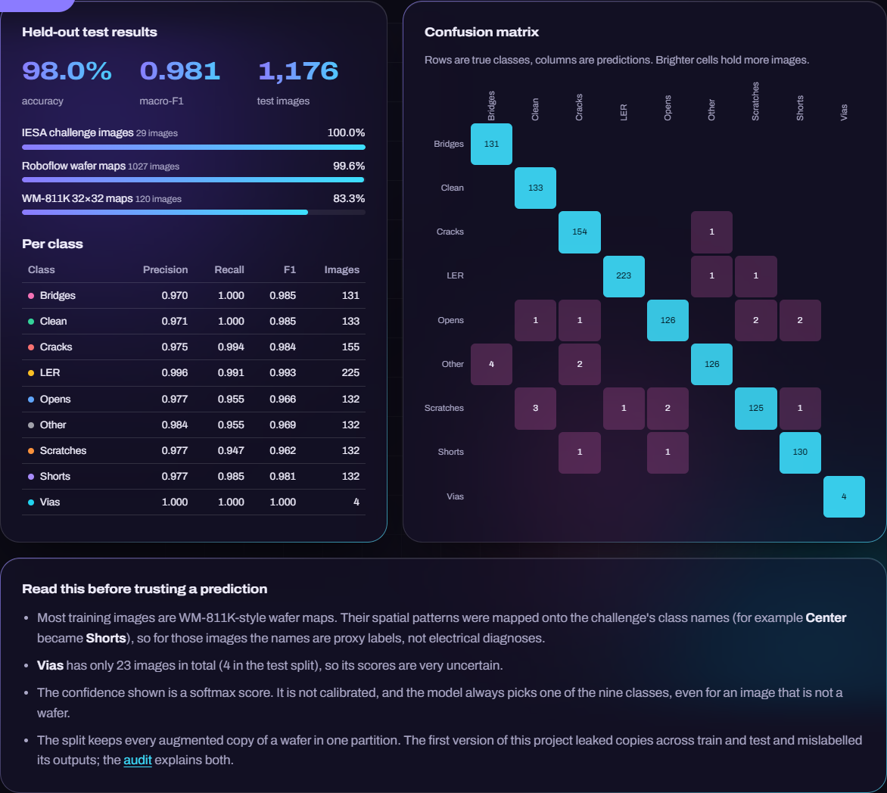
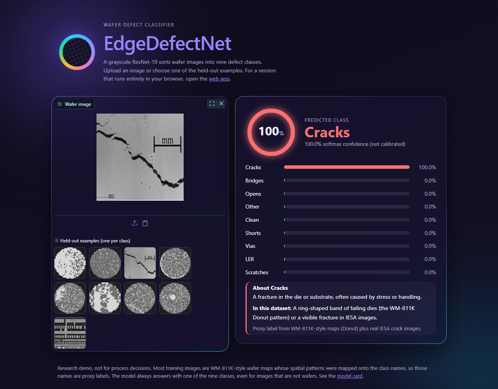

# EdgeDefectNet

[](https://github.com/Sandeepsrinivasan-14/EdgeDefectNet/actions/workflows/ci.yml)


[](LICENSE)
[](https://sandeepsrinivasan-14.github.io/EdgeDefectNet/)

Wafer defect classification with a grayscale ResNet-18. Nine classes, a leakage-free train/validation/test split,
an ONNX model you can run with three small dependencies, and a web app that runs the model **in your browser**.

Documentation: [Model card](MODEL_CARD.md) | [Changelog](CHANGELOG.md) | [Contributing](CONTRIBUTING.md) |
[Security policy](SECURITY.md) | [v1 audit](reports/v1_audit.md)



## Results (held-out test split)

| Metric | Value |
|---|---|
| Accuracy | **97.96%** (1,176 images) |
| Macro-F1 | 0.981 |
| Weighted-F1 | 0.980 |
| Validation accuracy / macro-F1 (model selection) | 97.45% / 0.966 |

| Class | Precision | Recall | F1 | Test images |
|---|---|---|---|---|
| Bridges | 0.970 | 1.000 | 0.985 | 131 |
| Clean | 0.971 | 1.000 | 0.985 | 133 |
| Cracks | 0.975 | 0.994 | 0.984 | 155 |
| LER | 0.996 | 0.991 | 0.993 | 225 |
| Opens | 0.977 | 0.955 | 0.966 | 132 |
| Other | 0.984 | 0.955 | 0.969 | 132 |
| Scratches | 0.977 | 0.947 | 0.962 | 132 |
| Shorts | 0.977 | 0.985 | 0.981 | 132 |
| Vias | 1.000 | 1.000 | 1.000 | 4 |

| Accuracy by source | Images | Accuracy |
|---|---|---|
| Roboflow wafer-map renderings (`MULTI_CLASS`) | 1,027 | 99.6% |
| IESA challenge images | 29 | 100% |
| WM-811K 32x32 wafer maps | 120 | **83.3%** |

How to read these numbers:

- The test split was used once, after training finished; model selection used validation macro-F1 only.
- The low-resolution WM-811K images are clearly harder than the Roboflow renderings. Most errors come from them.
- *Vias* has 4 test images, so its perfect score carries almost no information. The macro-F1 is pulled up by it;
  accuracy and weighted-F1 are the more reliable summaries.
- Full metrics: [`reports/metrics_test.json`](reports/metrics_test.json),
  [confusion matrix](reports/confusion_matrix_test.png), [training curves](reports/training_curves.png).

### What changed from v1

v1 reported 98.1% accuracy, but an [audit](reports/v1_audit.md) found two problems:

1. **Shifted class names.** The model outputs classes in alphabetical (ImageFolder) order, but inference and the
   metrics report named them with a different list, so predictions and the per-class table were mislabelled.
2. **Train/test leakage.** Augmented copies of the same wafer appeared in both training and test data. On test
   images whose wafer was genuinely unseen, v1 scored 96.9%.

v2 uses one class list everywhere (guarded by a test), splits by original wafer so no copy crosses splits
(`data/manifest.csv`, also tested), and retrains from ImageNet weights. Its 97.96% is measured on a split with
no leakage at all.

## Web app

`web/` is a static site with a glassmorphism UI (dark and light themes, responsive, keyboard accessible). Drop an image
(anywhere on the page), paste one, or pick a held-out example, and the ONNX model runs locally through ONNX Runtime
Web (WebAssembly). Results show an animated confidence gauge, ranked probability bars and an explainer for the
predicted class; the model card section reads the real test metrics and draws the confusion matrix.

The selected image is mapped onto an interactive 3D wafer (three.js: drag or use the arrow keys to rotate). Its rim
carries nine coloured arcs, one per class, whose brightness follows the model's probabilities. The arcs are an index
of the classes, not a defect locator. three.js loads lazily, respects `prefers-reduced-motion`, and falls back to a 2D
canvas when WebGL is unavailable. three.js and ONNX Runtime Web are loaded from pinned CDN versions with
Subresource Integrity hashes; the model, images and metrics are self-hosted.

| Prediction | Model card |
|---|---|
|  |  |

```bash
python scripts/build_site.py              # assembles _site/ (web app + model + examples + metrics)
python -m http.server -d _site 8000       # open http://localhost:8000
```

The **Web app (GitHub Pages)** workflow builds `_site/` on every push and pull request and deploys it from `main`.
One-time setup: repository **Settings → Pages → Build and deployment → Source: GitHub Actions** (or
`gh api -X POST repos/<owner>/<repo>/pages -f build_type=workflow`). If Pages is not enabled the workflow still
builds the site, then reports a warning with this instruction instead of failing with a 404. A browser test
(`tests/test_web.py`) checks that the web app's predictions match the Python predictor on every example.

## Quick start (inference)

```bash
git clone https://github.com/Sandeepsrinivasan-14/EdgeDefectNet && cd EdgeDefectNet
pip install .                              # onnxruntime, numpy, pillow (or: pip install -r requirements.txt)
edgedefectnet-predict examples/*.png       # same as python -m edgedefectnet.predict
edgedefectnet-predict my_wafer.png --top 3 --json
```

The CLI keeps going past unreadable images and exits with status 1 if any image failed and 2 if the model could not
be loaded. `--verify` checks the model's SHA-256 first.

```text
Bridges__MULTI_CLASS.png: Bridges (99.8%)  [next: Other 0.2%, LER 0.0%]
Cracks__IESA.png: Cracks (100.0%)  [next: Bridges 0.0%, Opens 0.0%]
Other__MULTI_CLASS.png: Other (99.0%)  [next: Bridges 1.0%, Cracks 0.0%]
```

From Python:

```python
from edgedefectnet.predict import Predictor

pred = Predictor().predict("my_wafer.png")
print(pred.label, pred.confidence, pred.probabilities)
```

Errors are explicit: `FileNotFoundError` for a missing file, `InvalidImageError` (a `ValueError`) for empty,
undecodable, oversized (over 25 MB or 64 megapixels) or tiny (under 8 px) images, and `ModelError` for a corrupt,
empty or Git-LFS-pointer model file or a failed checksum.

### Model file

The wheel contains code only; the 44.7 MB model lives in `models/edgedefectnet.onnx` in a source checkout. Elsewhere
download `edgedefectnet.onnx` and its `.sha256` (from `models/` in the repository, or from a
[GitHub Release](https://github.com/Sandeepsrinivasan-14/EdgeDefectNet/releases) once one has been published) and point
`EDGEDEFECTNET_MODEL` at it (or pass `model_path=` / `--model`). Why the model is stored in Git rather than Git LFS,
and how to ship the next one, is explained in [CONTRIBUTING.md](CONTRIBUTING.md#how-model-files-are-stored-and-why).

### Gradio demo and Docker

```bash
pip install ".[demo]" && python app.py                  # http://127.0.0.1:7860
docker build -t edgedefectnet .
docker run --rm -p 7860:7860 edgedefectnet              # http://localhost:7860
docker run --rm -v "$PWD:/data:ro" edgedefectnet python -m edgedefectnet.predict /data/my_wafer.png
```

The demo (`app.py`, styled by `app.css`) shows the same gauge, bars and class explainers
(Gradio 6); it classifies in-memory images only, so uploads never reach the file system.



The image is based on `python:3.12-slim`, runs as an unprivileged user, includes a health check, and has no
authentication: put it behind a reverse proxy before exposing it beyond localhost. `HOST` and `PORT` select the
bind address.

## Classes and data

The nine classes come from the IESA challenge: Bridges, Clean, Cracks, LER, Opens, Other, Scratches, Shorts, Vias.
Most images are WM-811K-style wafer maps whose spatial failure patterns were mapped onto these names (for
example *Center* to *Shorts*, *Donut* to *Cracks*, *Edge-Ring* and *Edge-Loc* to *LER*). For those images the
class names are **proxy labels**: the model recognises the spatial pattern, not the electrical defect. The full
mapping, sources and rebuild instructions are in [`data/README.md`](data/README.md).

Images are not stored in Git. `data/manifest.csv` lists every image with its split, class, source and wafer group,
and `scripts/build_dataset.py` rebuilds the dataset from the raw sources.

## Training

```bash
pip install -r requirements-train.txt
# ImageNet-pretrained ResNet-18 in torchvision format (timm's ResNet-18 A1 weights)
curl -L -o weights/resnet18.pth --create-dirs \
  https://github.com/huggingface/pytorch-image-models/releases/download/v0.1-rsb-weights/resnet18_a1_0-d63eafa0.pth

python -m edgedefectnet.train --data dataset --imagenet-weights weights/resnet18.pth --out checkpoints --epochs 10
python -m edgedefectnet.export --checkpoint checkpoints/best.pt --out models/edgedefectnet.onnx
python -m edgedefectnet.evaluate --data dataset --split test --model models/edgedefectnet.onnx --out reports
```

Setup used for the published model: 1-channel ResNet-18 (ImageNet filters averaged to grayscale), 224x224 input,
AdamW (lr 3e-4, weight decay 1e-4) with cosine decay, batch 32, class-weighted cross-entropy (weights capped at
10), light augmentation (rotation ±10°, crop 90-100%, horizontal flip), seed 42, 10 epochs on CPU (about 8
minutes per epoch). The best validation checkpoint was epoch 10. The run was interrupted once by a machine
restart after epoch 2 and resumed from that checkpoint with a fresh optimizer state; `--resume` now saves full
optimizer and scheduler state every epoch.

## Project layout

```text
edgedefectnet/        package: classes (names + descriptions), preprocessing, splits, model, data, train, evaluate, export, predict
models/               edgedefectnet.onnx (single file, dynamic batch, opset 17)
web/                  browser app (index.html, style.css, app.js, inference.js, wafer3d.js, self-hosted Archivo font)
examples/             one held-out test image per class
data/                 manifest.csv and dataset documentation
reports/              test/validation metrics, confusion matrices, training history, v1 audit
scripts/              build_dataset.py, build_site.py, plot_history.py
tests/                classes and split leakage, inference, ONNX export parity, browser parity
app.py, app.css       Gradio demo and its stylesheet
pyproject.toml        packaging, pytest, coverage and mypy configuration
Dockerfile            container for the Gradio demo and CLI
MODEL_CARD.md         intended use, data, metrics, limitations
```

## Development

```bash
pip install -e ".[dev,demo]"  # add ,train for the PyTorch tests
pytest --cov                  # torch, browser and demo tests are skipped if those packages are missing
ruff check . && ruff format --check . && mypy
```

CI (`.github/workflows/ci.yml`) runs lint and type checks, a test matrix (Linux with Python 3.10-3.13, plus macOS and
Windows), the browser parity test, the PyTorch tests, a package build with a clean-install check and a Docker build.
CodeQL and Dependabot are enabled; tagging `vX.Y.Z` publishes a release with the wheel, the model and its checksum.

## License

[MIT](LICENSE) © Sandeep Srinivasan. The Archivo font is under the SIL Open Font License (`web/fonts/OFL-Archivo.txt`).
Check each dataset source's licence before redistributing images.
